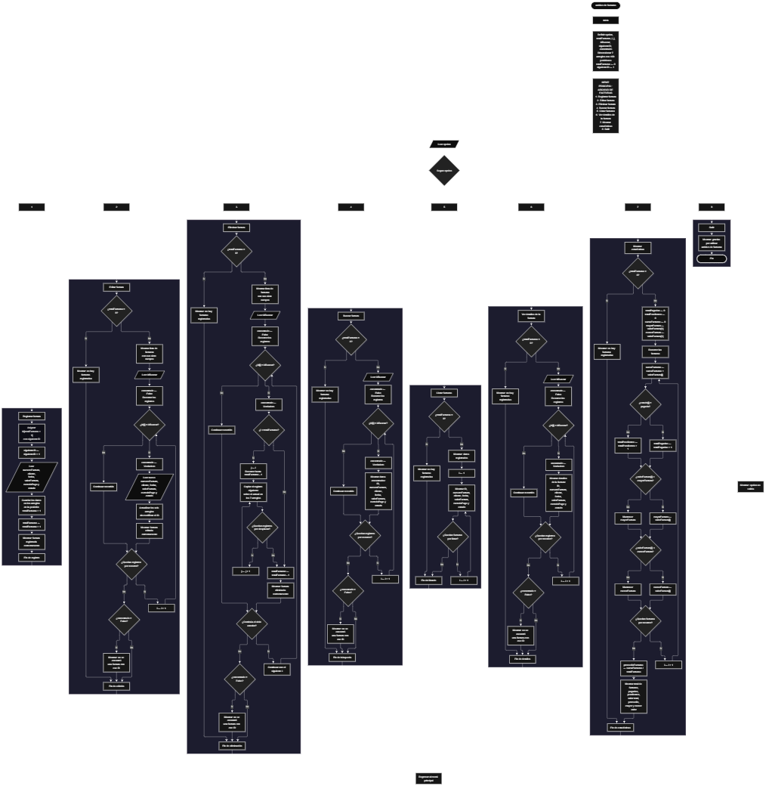

 

Este proyecto, llamado <b>archivo de facturas</b>, fue desarrollado en <b>pseint</b> como un ejercicio práctico para fortalecer la lógica de programación mediante la creación de un sistema de gestión de facturas desde la consola. El programa cuenta con un menú principal de ocho opciones que permite <b>registrar, editar, eliminar, buscar, listar y consultar los detalles</b> de las facturas, además de mostrar estadísticas generales y salir del sistema. Cada factura almacena datos como el número de factura, el cliente, la fecha, el valor, el método de pago y el estado, utilizando arreglos con una capacidad de <b>100 posiciones durante la ejecución</b>. Durante su desarrollo se aplicaron conceptos fundamentales de programación, como variables, arreglos, estructuras condicionales, ciclos repetitivos y estructuras de selección, además de procesos para buscar, modificar, eliminar y organizar registros. Este proyecto permite poner en práctica los conocimientos adquiridos en PSeInt y sirve como base para desarrollar sistemas de gestión de facturas más avanzados utilizando otros lenguajes y tecnologías.

<h2 align="center">⚙️ Funcionamiento del menú principal</h2>

### ➕ Registrar factura

La opción <b>1) registrar factura</b> permite registrar una nueva factura en el sistema. Para comenzar, el programa asigna un identificador único mediante la variable <b>siguienteID</b>, almacena el valor en el arreglo <b>id</b> y aumenta el identificador en uno para el siguiente registro. Después, solicita el <b>número de factura, nombre del cliente, fecha, valor de la factura, método de pago y estado</b>, almacenando cada dato en la posición correspondiente de sus respectivos arreglos. Finalmente, aumenta la variable <b>totalFacturas</b> en uno y muestra el mensaje <b>"factura registrada correctamente."</b>. El programa utiliza arreglos de 100 posiciones, pero no comprueba si se ha alcanzado la capacidad máxima antes de registrar una nueva factura.

### ✏️ Editar factura

La opción <b>2) editar factura</b> permite modificar la información de una factura registrada. Primero, el programa comprueba si existen facturas almacenadas mediante la variable <b>totalFacturas</b>. Si no hay registros, muestra el mensaje <b>"no hay facturas registradas."</b>. En caso contrario, presenta una lista con el ID, número de factura, cliente, fecha, valor, método de pago y estado de cada registro. Después, solicita el ID de la factura que se desea editar e inicializa la variable lógica <b>encontrado</b> con el valor <b>falso</b>. Mediante un ciclo <b>para</b>, recorre los registros y compara el identificador introducido con los valores almacenados en el arreglo <b>id</b>. Si encuentra una coincidencia, cambia <b>encontrado</b> a <b>verdadero</b>, solicita los nuevos datos y actualiza los arreglos correspondientes, sin modificar el ID de la factura. Finalmente, muestra el mensaje <b>"factura editada correctamente."</b>. Si no encuentra el identificador solicitado, presenta el mensaje <b>"no se encontró una factura con ese id."</b>.

### 🗑️ Eliminar factura

La opción <b>3) eliminar factura</b> permite eliminar una factura registrada mediante su identificador. Antes de comenzar, el programa comprueba si existen facturas almacenadas. Si no hay registros, muestra el mensaje <b>"no hay facturas registradas."</b>. Si existen facturas, presenta una lista con sus datos y solicita el ID de la factura que se desea eliminar. Después, inicializa la variable lógica <b>encontrado</b> con el valor <b>falso</b> y recorre los registros mediante un ciclo <b>para</b>. Cuando encuentra una coincidencia, cambia la variable a <b>verdadero</b> y comprueba si la posición seleccionada es anterior a la última factura registrada. Si existen registros posteriores, utiliza otro ciclo <b>para</b>, controlado por la variable <b>j</b>, para desplazar una posición hacia la izquierda los datos de los arreglos <b>id, numeroFactura, cliente, fecha, valorFactura, metodoPago y estado</b>. Posteriormente, disminuye la variable <b>totalFacturas</b> en uno y muestra el mensaje <b>"factura eliminada correctamente."</b>. El código no limpia explícitamente la última posición después de eliminar y continúa el recorrido del ciclo exterior. Si no encuentra el ID solicitado, muestra el mensaje <b>"no se encontró una factura con ese id."</b>.

### 🔎 Buscar factura

La opción <b>4) buscar factura</b> permite localizar una factura mediante su identificador. Primero, el programa comprueba si existen facturas registradas. Si no hay registros, muestra el mensaje <b>"no hay facturas registradas."</b>. En caso contrario, solicita el ID de la factura que se desea buscar e inicializa la variable lógica <b>encontrado</b> con el valor <b>falso</b>. A continuación, utiliza un ciclo <b>para</b> para recorrer los identificadores almacenados y compararlos con el valor introducido mediante la condición <b>id[i] = idBuscar</b>. Cuando encuentra una coincidencia, cambia la variable a <b>verdadero</b>, muestra el mensaje <b>"datos encontrados"</b> y presenta en una sola línea el ID, número de factura, cliente, fecha, valor, método de pago y estado. Si finaliza el recorrido sin encontrar coincidencias, presenta el mensaje <b>"no se encontró una factura con ese id."</b>. La búsqueda se realiza mediante el ID y no mediante el número de factura o el nombre del cliente.

### 📋 Listar facturas

La opción <b>5) listar facturas</b> permite visualizar todas las facturas registradas actualmente en el sistema. Antes de mostrar la información, el programa comprueba si la variable <b>totalFacturas</b> es igual a cero. Si no existen registros, presenta el mensaje <b>"no hay facturas registradas."</b>. Si hay facturas disponibles, muestra el mensaje <b>"datos registrados"</b> y utiliza un ciclo <b>para</b> para recorrer los arreglos desde la primera posición hasta el número total de facturas registradas. Durante el recorrido, presenta el ID, número de factura, cliente, fecha, valor, método de pago y estado de cada registro en una sola línea. Esta función facilita consultar las facturas almacenadas sin necesidad de buscar cada una individualmente.

### 📄 Ver detalles de la factura

La opción <b>6) ver detalles de la factura</b> permite consultar individualmente todos los datos de una factura específica. Primero, el programa comprueba si existen facturas registradas. Si no hay registros, muestra el mensaje <b>"no hay facturas registradas."</b>. En caso contrario, solicita el ID de la factura que se desea consultar e inicializa la variable lógica <b>encontrado</b> con el valor <b>falso</b>. Después, utiliza un ciclo <b>para</b> para recorrer los identificadores y comprobar si alguno coincide con el valor introducido. Si encuentra la factura, cambia la variable a <b>verdadero</b>, muestra el encabezado <b>"detalles de la factura"</b> y presenta cada campo por separado: ID, número de factura, cliente, fecha, valor de la factura, método de pago y estado. Si no encuentra el registro solicitado, presenta el mensaje <b>"no se encontró una factura con ese id."</b>.

### 📊 Mostrar estadísticas

La opción <b>7) mostrar estadísticas</b> permite obtener un resumen general de las facturas registradas. Primero, el programa comprueba si existen registros. Si no hay facturas, muestra el mensaje <b>"no hay facturas registradas."</b>. En caso contrario, inicializa las variables <b>totalPagadas</b>, <b>totalPendientes</b> y <b>sumaFacturas</b> en cero. También utiliza el primer valor del arreglo <b>valorFactura</b> para inicializar <b>mayorFactura</b> y <b>menorFactura</b>. Mediante un ciclo <b>para</b>, suma los valores de todas las facturas, cuenta como pagadas aquellas cuyo estado sea exactamente <b>"pagada"</b> y clasifica como pendientes las que tengan cualquier otro estado. Durante el recorrido, compara los importes para identificar el mayor y el menor valor. Al finalizar, calcula <b>promedioFacturas</b> dividiendo la suma de los valores entre <b>totalFacturas</b> y presenta el total de facturas, las pagadas, las pendientes, el valor total facturado, el promedio y los importes máximo y mínimo. Las variables utilizadas para estos cálculos no aparecen declaradas en la sección inicial del código.

### 🚪 Salir del menú principal

La opción <b>8) salir</b> está destinada a finalizar la ejecución del programa y muestra el mensaje <b>"gracias por utilizar archivo de facturas."</b>. El menú principal se encuentra dentro de una estructura repetitiva <b>repetir ... hasta que</b>, cuya condición final es <b>hasta que opcion = 8</b>. Cuando el usuario selecciona esta opción, la condición se cumple y el ciclo termina, finalizando el menú principal. A diferencia de las operaciones de gestión, esta opción no modifica los registros almacenados; simplemente muestra el mensaje de despedida y permite terminar la ejecución del algoritmo.

<h2 align="center">🧠 Temas aplicados en el proyecto</h2>

### 📦 Variables

En este proyecto se utilizan variables para guardar la opción seleccionada en el menú, controlar la cantidad de facturas registradas, generar identificadores consecutivos, recorrer los arreglos, localizar las facturas que se desean editar, eliminar o consultar y comprobar si se encontró una coincidencia. También se emplean variables para acumular los valores de las facturas, contar los registros según su estado y calcular las estadísticas generales. Cada variable cumple una función específica dentro de las operaciones de gestión de facturas.

🔢 **Opcion:** Almacena la opción seleccionada por el usuario en el menú principal.

📊 **TotalFacturas:** Almacena la cantidad actual de facturas registradas.

🔄 **I:** Funciona como contador en los ciclos <b>para</b> y permite recorrer las posiciones de los arreglos.

🔁 **J:** Controla el recorrido utilizado para desplazar los datos durante la eliminación de una factura.

🆔 **SiguienteID:** Genera identificadores consecutivos para las nuevas facturas registradas.

🔎 **IDBuscar:** Almacena el identificador introducido por el usuario para localizar una factura.

✅ **Encontrado:** Variable lógica que indica si se encontró una factura con el ID solicitado.

💰 **TotalPagadas:** Cuenta las facturas cuyo estado es exactamente <b>"pagada"</b>. Se utiliza en las estadísticas.

⏳ **TotalPendientes:** Cuenta las facturas cuyo estado es diferente de <b>"pagada"</b>. Se utiliza en las estadísticas.

🧮 **SumaFacturas:** Acumula los valores de las facturas registradas para calcular el importe total.

📈 **MayorFactura:** Almacena el valor más alto encontrado entre las facturas registradas.

📉 **MenorFactura:** Almacena el valor más bajo encontrado entre las facturas registradas.

📊 **PromedioFacturas:** Almacena el promedio de los valores de las facturas registradas.

### 🗃️ Arreglos

En este proyecto se utilizan siete arreglos relacionados con los datos de cada factura. Cada arreglo tiene una capacidad de <b>100 posiciones</b> y utiliza el mismo índice para representar la información correspondiente a un mismo registro. Por ejemplo, los datos de una factura almacenada en la posición <b>1</b> se encuentran distribuidos entre <b>id[1], numeroFactura[1], cliente[1], fecha[1], valorFactura[1], metodoPago[1] y estado[1]</b>. Esta organización permite recorrer, buscar, modificar, mostrar y eliminar facturas manteniendo relacionados sus respectivos campos. La cantidad de registros activos se controla mediante la variable <b>totalFacturas</b>, aunque el programa no verifica que se haya alcanzado la capacidad máxima de los arreglos.

🆔 **Id[100]:** Almacena los identificadores consecutivos asignados a las facturas.

🧾 **NumeroFactura[100]:** Almacena los números de las facturas registradas.

👤 **Cliente[100]:** Almacena los nombres de los clientes asociados a cada factura.

📅 **Fecha[100]:** Almacena las fechas correspondientes a las facturas.

💵 **ValorFactura[100]:** Almacena los valores monetarios de las facturas.

💳 **MetodoPago[100]:** Almacena los métodos de pago de las facturas.

📌 **Estado[100]:** Almacena el estado de cada factura, utilizado también para clasificar los registros en las estadísticas.

### 🔀 Estructuras condicionales

En este proyecto se utilizan las estructuras <b>si</b> y <b>sino</b> para comprobar si existen facturas registradas antes de realizar determinadas operaciones, verificar si el ID introducido coincide con alguno de los identificadores almacenados, determinar si se debe desplazar información durante la eliminación y clasificar las facturas según su estado. También se utilizan condiciones para comparar los valores de las facturas y determinar cuál es el mayor y el menor. Estas estructuras permiten que el programa ejecute instrucciones diferentes según el estado de los registros y los resultados de cada comparación.

### 🔄 Estructuras repetitivas

En este proyecto se utilizan los ciclos <b>para</b> y <b>repetir ... hasta que</b>. Los ciclos <b>para</b> permiten recorrer los arreglos para mostrar las facturas, localizar identificadores, modificar registros y calcular estadísticas. Durante la eliminación, también se utiliza un ciclo para desplazar los datos de las facturas posteriores una posición hacia la izquierda. Por otro lado, el ciclo <b>repetir ... hasta que</b> mantiene activo el menú principal y permite ejecutar diferentes operaciones hasta que el usuario selecciona la opción <b>8) salir</b>.

### 🎯 Estructura según

El programa evalúa el valor almacenado en la variable <b>opcion</b> y ejecuta el bloque de instrucciones correspondiente mediante la estructura <b>segun opcion hacer</b>. Cada caso representa una operación específica del sistema: <b>registrar, editar, eliminar, buscar, listar, ver detalles, mostrar estadísticas o salir</b>. También se utiliza el bloque <b>de otro modo</b> para mostrar el mensaje <b>"opcion no valida."</b> cuando el usuario introduce un valor que no coincide con ninguna de las opciones definidas en el menú. Esta estructura organiza las operaciones y facilita la navegación por las funciones del programa.

### 🔢 Dimensionamiento de arreglos

El programa utiliza la instrucción <b>dimension</b> para establecer la capacidad de los arreglos que almacenan la información de las facturas. Se definieron <b>100 posiciones</b> para cada uno de los siete arreglos, lo que permite administrar hasta 100 facturas dentro de la capacidad prevista durante la ejecución. La cantidad de posiciones ocupadas se controla mediante la variable <b>totalFacturas</b>, por lo que las operaciones recorren los registros desde la primera posición hasta el total actual de facturas. Sin embargo, el código no incorpora una comprobación que impida registrar una factura cuando se alcanza el límite de almacenamiento.

### 🔄 Reorganización de registros

Cuando se selecciona una factura para eliminarla, el programa utiliza un ciclo <b>para</b> que comienza en la posición seleccionada y llega hasta <b>totalFacturas - 1</b>, siempre que la factura no ocupe la última posición. En cada repetición, los datos de la posición siguiente se copian sobre la posición actual en los siete arreglos: <b>id, numeroFactura, cliente, fecha, valorFactura, metodoPago y estado</b>. Después, la variable <b>totalFacturas</b> disminuye en uno. El código no limpia explícitamente la última posición que deja de formar parte de los registros activos, pero las operaciones posteriores recorren el arreglo únicamente hasta el total actualizado. De esta manera, los registros activos quedan organizados sin dejar posiciones intermedias vacías entre las facturas restantes.

<h2 align="center">¿Cómo se implementaron las operaciones crud en el proyecto?</h2>

Las operaciones <b>crud</b> se implementaron mediante las opciones del menú principal, permitiendo administrar las facturas registradas. La operación <b>crear</b> corresponde a <b>registrar factura</b>, donde se asigna un ID y se introducen los datos de un nuevo registro; <b>leer</b> se realiza mediante las opciones <b>buscar factura, listar facturas y ver detalles de la factura</b>; <b>actualizar</b> corresponde a <b>editar factura</b>, donde se modifican los datos de una factura existente sin cambiar su identificador; y <b>eliminar</b> se realiza mediante la opción <b>eliminar factura</b>, que desplaza los registros posteriores para reorganizar los arreglos. Además, la opción <b>mostrar estadísticas</b> permite obtener información general sobre los importes y estados de las facturas. Estas operaciones utilizan variables, arreglos, condicionales y ciclos para gestionar la información almacenada temporalmente durante la ejecución del programa.

<h2 align="center">Diagrama de flujo del proyecto</h2>

<h2 align="center">🛡️ Validaciones del programa</h2>

### 📭 No existen facturas registradas

Esta comprobación se utiliza en las opciones de <b>editar, eliminar, buscar, listar, ver detalles y mostrar estadísticas</b>. El programa verifica si la variable <b>totalFacturas</b> es igual a <b>0</b> y, si no existen facturas registradas, muestra el mensaje <b>"no hay facturas registradas."</b>. Esta condición evita continuar con las operaciones que necesitan información almacenada cuando el archivo de facturas está vacío.

### ⚠️ Capacidad de los arreglos

Los arreglos del programa tienen una capacidad de <b>100 posiciones</b>. Sin embargo, en la opción de registro no se comprueba si la variable <b>totalFacturas</b> ha alcanzado ese límite antes de almacenar una nueva factura. Por este motivo, el código actual no incorpora una validación que impida superar la capacidad prevista. Para mantener la correspondencia entre los registros y los arreglos, sería necesario añadir una condición que compruebe si existe espacio disponible antes de iniciar el registro.

### ❌ Factura no encontrada

Esta comprobación se utiliza durante las operaciones de <b>editar, eliminar, buscar y ver detalles de la factura</b>. El programa inicializa la variable lógica <b>encontrado</b> con el valor <b>falso</b> y recorre el arreglo <b>id</b> para comparar cada identificador con el valor introducido por el usuario. Cuando encuentra una coincidencia, cambia la variable a <b>verdadero</b> y ejecuta la operación correspondiente. Si al finalizar el recorrido la variable continúa siendo <b>falso</b>, muestra el mensaje <b>"no se encontró una factura con ese id."</b>. Esta comprobación permite informar al usuario cuando el identificador solicitado no corresponde a ninguna factura registrada.

### 📌 Clasificación de estados

Esta comprobación se utiliza en la opción <b>7) mostrar estadísticas</b> para clasificar las facturas según su estado. El programa compara cada valor del arreglo <b>estado</b> con el texto <b>"pagada"</b>. Si ambos coinciden, incrementa la variable <b>totalPagadas</b>; en caso contrario, incrementa <b>totalPendientes</b>. El código no verifica que el estado introducido sea válido ni contempla otras categorías específicas. Por tanto, cualquier valor diferente de <b>"pagada"</b> se contabiliza como pendiente, aunque el texto almacenado no corresponda necesariamente a una factura pendiente.

### 🔢 Identificadores de las facturas

El programa utiliza la variable <b>siguienteID</b> para asignar identificadores consecutivos a las nuevas facturas. Después de asignar el identificador al arreglo <b>id</b>, incrementa la variable en uno para preparar el siguiente registro. Cuando se elimina una factura, el identificador de las facturas restantes se conserva durante el desplazamiento de los arreglos, por lo que los ID no se renumeran. Además, la variable <b>siguienteID</b> no disminuye después de una eliminación, evitando reutilizar los identificadores eliminados durante la misma ejecución.

### ⚠️ Opción inválida

La estructura <b>segun</b> incluye el bloque <b>de otro modo</b>, que muestra el mensaje <b>"opcion no valida."</b> cuando el usuario introduce un valor que no corresponde a ninguna de las ocho opciones del menú. Esta comprobación permite informar sobre selecciones no contempladas. Sin embargo, el código no valida otros datos introducidos al registrar o editar una factura, como el formato de la fecha, la unicidad del número de factura, la validez del método de pago o la correspondencia del estado con una lista de valores permitidos.

<h2 align="center">🎯 Objetivo del proyecto</h2>

El objetivo principal de este proyecto es fortalecer la <b>lógica de programación</b> mediante el desarrollo de un sistema de gestión de facturas en <b>pseint</b>. A través de su construcción se busca aplicar los conocimientos adquiridos sobre variables, arreglos, estructuras condicionales, ciclos repetitivos y estructuras de selección, integrándolos para resolver un problema de manera organizada. Además, el proyecto permite comprender cómo registrar, consultar, modificar y eliminar información, así como calcular estadísticas a partir de los datos almacenados temporalmente en una aplicación de consola. De esta manera, se establece una base para desarrollar sistemas de facturación y gestión administrativa más completos utilizando otros lenguajes y tecnologías.

